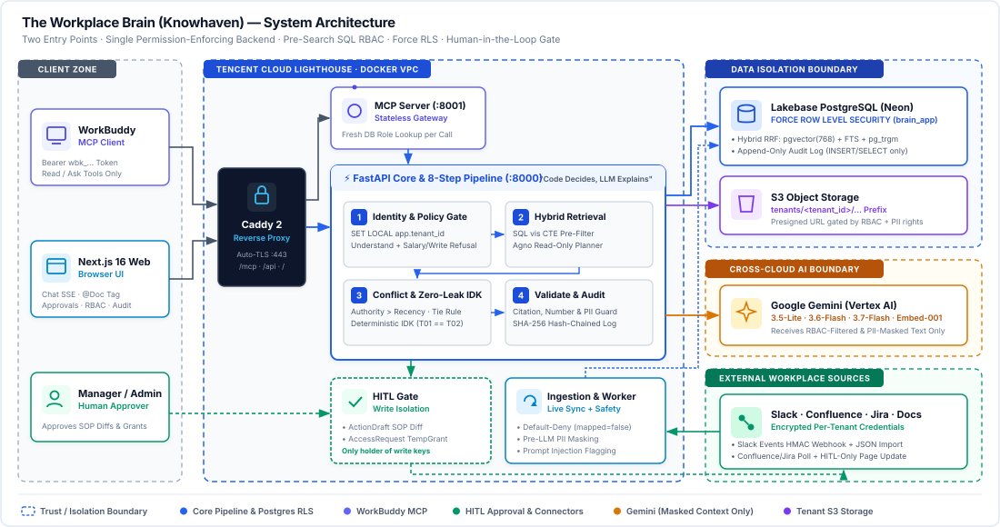

# Knowhaven (Havi) — The Workplace Brain

> **Short Blurb (<10 words):** Company knowledge answers that respect every access boundary.

**Challenge Track:** Challenge A — The Workplace Brain  
**Event:** AI CAN DO IT · Tencent Cloud Hackathon Indonesia 2026  
**Companion Docs:** [1-Page Accountability Sheet](./ACCOUNTABILITY_SHEET.md) · [Accountability Test Results (T01–T33)](./TEST_RESULTS.md)

---

## 1. Overview & Real-World Insight

In Indonesian enterprises, operational truth is fragmented across **chat** (Slack & WhatsApp groups), **documents** (Confluence SOPs, PDFs, meeting notes), and **tasks** (Jira). Standard RAG chatbots fail in real workplaces for two reasons:
1. **They leak what exists:** Even when a bot refuses to show a secret document, saying *"You don't have permission to view Proyek Kenari"* confirms that a confidential acquisition named *Kenari* exists.
2. **They guess when sources disagree:** When an older HR SOP says fuel allowance is `Rp500.000` and a newer HR announcement says `Rp750.000`, naive LLMs pick arbitrarily or hallucinate.

**Knowhaven (Havi)** solves both with a simple architectural rule: **"Two Entry Doors, One Permission-Enforcing Backend — LLM Extracts, Code Decides, LLM Explains."** Whether an employee asks via our **Next.js Web App** or **Tencent WorkBuddy Desktop (MCP)**, every query runs through the same 8-step accountable pipeline backed by PostgreSQL `FORCE ROW LEVEL SECURITY`.

---

## 2. System Architecture & Trust Boundaries



### Explicit Trust Boundaries

| Boundary | What Crosses It | How It Is Enforced |
| :--- | :--- | :--- |
| **TB-1 · Client Entry** | Browser HTTP & WorkBuddy MCP calls | Identity comes strictly from `HttpOnly` session cookies (+ CSRF) or SHA-256 `wbk_...` MCP tokens. Role claims inside chat (`"Saya HRD..."`) or headers are ignored; roles are re-read from PostgreSQL on every request. |
| **TB-2 · Pre-Search SQL RBAC** | User query → Retrieval tools | `RequestContext` is injected by backend code—never by LLM tool arguments. A single SQL `vis` CTE filters out unmapped, deleted, or unauthorized items *before* vector, full-text, or trigram scoring runs. |
| **TB-3 · Database Force RLS** | Backend session → Lakebase Postgres | Runtime connects as `brain_app` (`NOBYPASSRLS`). All 19 tenant tables enforce `FORCE ROW LEVEL SECURITY` on `current_setting('app.tenant_id')::uuid`. `audit_log` grants only `INSERT, SELECT` to `brain_app`. |
| **TB-4 · HITL Write Gate** | SOP update diffs & Gated access requests | The agent has **zero write credentials**. Stale SOP conflicts create a pending `ActionDraft`; only after a manager approves in `/approvals` does `executors.execute()` update Confluence or grant a time-limited `TempGrant`. |
| **TB-5 · Cross-Cloud AI** | Filtered chunks → Gemini (Vertex AI) | Personal data (NIK, NPWP, phone, personal email, bank account) is masked into `text_masked` at ingestion. Raw PII is unmasked only when `role ∈ pii_permissions ∧ needs_pii == True`. |

### Key Design Trade-Offs

| Decision | Alternative Rejected | Why We Made This Trade-Off |
| :--- | :--- | :--- |
| **High-level MCP tool (`ask_workplace_brain`) for WorkBuddy** | Exposing raw vector/SQL search tools to WorkBuddy | If WorkBuddy's desktop LLM composed answers from raw chunks, our deterministic conflict resolver (R4), zero-leak IDK template (R3/R5), and citation validator (R1) could be bypassed. |
| **Pre-search SQL `vis` CTE vs. Agno dynamic filters** | Agno `enable_agentic_knowledge_filters` or top-K post-filtering | Letting the LLM choose filter values risks privilege escalation; post-filtering top-K leaks item existence via score shifts. Pre-filtering in SQL guarantees byte-identical responses (`T01 == T02`). |
| **"LLM Extracts, Code Decides, LLM Explains"** | Asking the LLM to pick the winning source in free-form text | Deterministic Python rules (`conflict.py`) guarantee 100% repeatable authority > recency > tie resolution and automatic HITL SOP draft creation. |
| **Dual chunk storage (`text_masked` + `text_raw`)** | Masking PII only in the final LLM prompt | Indexing `text_masked` prevents users from probing for a colleague's NIK/phone via search and ensures the LLM never receives raw PII unless authorized. |
| **Tiered Flash models + 4s hedged streaming** | Single large Pro model for all steps | `gemini-3.5-flash-lite` (Step 2/4), `3.6-flash` (Step 5), and `3.7-flash` hedged by `3.6-flash` (Step 6) keep p95 latency well inside the 90-second live test budget. |

---

## 3. Compliance with the 5 Accountability Rules & Challenge A

| Rule / Req | Requirement Summary | How Knowhaven Implements It |
| :--- | :--- | :--- |
| **R1 · `SOURCES`** | Answer in ID, EN, or mixed; cite every source | Detects `id`/`en`/`mixed` + bilingual query expansion (`brp`→`berapa`, `fuel allowance`↔`uang bensin`). Step 7 (`validate.py`) verifies every substantive sentence cites `[CHAT-... \| DOC-... \| TASK-...]` in the user's allowed set and every number $\ge 10$ matches the cited source. |
| **R2 · `PERMISSIONS`** | Check auth before search; reflect access changes immediately | `load_context()` reads roles and `permission_state.version` fresh on every query. When access changes, stale conversation turns are trimmed and the response includes an `access_changed` notice. |
| **R3 · `PERMISSIONS`** | Refuse restricted queries without implying existence | Hidden containers (`#proyek-kenari`, `RAHASIA`, Jira `KNR`) are excluded in SQL. When 0 visible claims remain, `idk.py` returns a deterministic template using only the user's typed phrase. *Proyek Kenari* and non-existent *Proyek Merpati* produce byte-identical output and SSE event sequences. |
| **R4 · `SOURCES`** | Flag conflicts, explain which source won and why | Step 5 extracts claims; `conflict.py` resolves: (1) Authority over topic, (2) Newer authoritative source wins, (3) Newer HR announcement > older SOP marks SOP stale & proposes an `ActionDraft` diff, (4) Rumours marked `unverified`, (5) Same-day equal-authority ties show both values. |
| **R5 · `LIMITS`** | Say "I don't know" and route to subject-matter owner | Missing topics match public `topic_owners` (`open`/`gated` only, never `hidden`) and route to the owner (e.g., `"beasiswa S2"` → `HR Helpdesk (hr@srn-demo.id)`). |
| **R6 · `RECORD`** | Log every query, retrieved sources, and response | Step 8 writes all 8 `trace_events` and appends a SHA-256 hash-chained row (`prev_hash` → `row_hash`) to `audit_log` (append-only at the PostgreSQL role level, verifiable via `/audit`). |
| **Bonus B1** | Stay current as new messages/docs arrive | Live Slack Events API webhook (`message`, `message_changed`, `message_deleted`), 120s Confluence/Jira worker, instant web uploads, zero answer caching, and live `data_as_of` badge. |
| **Bonus B2** | Ignore prompt injections inside documents | Read-only agent tools + `<source flag="contains_instructions_to_ignore">` XML escaping + `DATA_RULE` system prompts + ingestion scanner (`injection.py`) that appends an explicit ignored-instruction warning when cited. |
| **Bonus B3** | Mask NIK & phone unless query requires it | Regex + province/DOB validation masks NIK, NPWP, phone, personal email, and bank accounts at ingestion; unmasked only when `role ∈ pii_permissions ∧ und.needs_pii == True`, plus a deterministic Step 7 output guard. |
| **Bonus B4** | Synthesize chat, document, and task in one answer | Parallel retrieval across `search_messages`, `search_documents`, and `query_tasks` synthesizes multi-source answers (e.g., Makassar stock delay cause from Slack/WhatsApp + escalation SOP from Confluence + open tickets from Jira `OPS`). |

---

## 4. One-Page Accountability Summary

> Full standalone sheet: **[`ACCOUNTABILITY_SHEET.md`](./ACCOUNTABILITY_SHEET.md)**

| Dimension | Policy & Technical Boundary |
| :--- | :--- |
| **🔍 Can Access** | Only data inside the user's active tenant (PostgreSQL `FORCE ROW LEVEL SECURITY`) across mapped (`mapped=true`) Slack channels, WhatsApp exports, Confluence spaces, uploaded documents, and Jira projects permitted by the user's active business roles, item overrides (`deny` beats `allow`), or active `temp_grants`. |
| **⚡ Executes Autonomously** | Language/intent analysis, pre-filtered hybrid RRF search, claim extraction, deterministic conflict resolution, PII masking, citation/number validation, HITL draft proposal, and append-only hash-chained audit logging. |
| **✋ Requires Human Approval** | 1. **External/Document Writes:** Applying a proposed SOP update (`ActionDraft` unified diff) to Confluence or internal docs.<br>2. **Privilege Elevation:** Granting temporary access (`TempGrant`) to `gated` topics such as Salary Grade Tables (`AccessRequest`). |
| **🚫 Will Never Do** | Never return data from another tenant; never confirm or imply that `hidden` content exists; never accept role claims from chat text or headers; never follow instructions embedded inside documents; never execute external writes without human approval; never send unmasked PII to the LLM without role permission and query need. |

---

## 5. WorkBuddy Integration & Product Sharing

### How WorkBuddy Connects to Knowhaven
Users generate a personal `wbk_...` token in **Settings → Hubungkan WorkBuddy** (`/settings/workbuddy`) and paste the generated snippet into `~/.workbuddy/mcp.json`. WorkBuddy connects over HTTPS to our stateless MCP server (`brain-mcp`), which exposes three read/ask-only tools:
- `ask_workplace_brain(question, conversation_id?)` — Runs the full 8-step accountable pipeline and returns the validated answer with citations.
- `open_source(item_id)` — Re-verifies permissions and returns the source chunks (returning identical `NOT_FOUND` for hidden and non-existent IDs).
- `whoami()` — Displays the user's live identity, active company, and database roles.

### Where WorkBuddy Added Value in Our Build
1. **Realistic Indonesian Enterprise Dataset Generation:** We used WorkBuddy to draft and cross-check our multi-tenant seed data (`PT Sinar Rantai Nusantara` and `CV Kopi Lereng Merapi`), including realistic Indonesian office slang (`brp`, `yg`, `utk`), multi-source causal chains (Makassar shipping delay across Slack, WhatsApp, Confluence, and Jira), and adversarial prompt injection traps.
2. **Adversarial Leak & Conflict Red-Teaming:** Connecting WorkBuddy as a live MCP client allowed us to test role changes in the web UI and immediately verify in WorkBuddy (`whoami` + `ask_workplace_brain`) that revoked permissions take effect on the very next tool call without re-issuing tokens.
3. **Key Learning:** Giving an external desktop agent raw search tools is a security trap—wrapping the entire policy and validation pipeline inside a single high-level MCP tool (`ask_workplace_brain`) is essential to preserve zero-leakage guarantees across clients.

---

## 6. Measurable Business Value

- **Faster Onboarding & Cross-Team Alignment:** Cuts policy and project lookup time from **15–30 minutes** (searching across Slack threads, Confluence spaces, and Jira boards) to **<10 seconds** with verifiable `[CHAT/DOC/TASK]` citations.
- **Zero-Leakage Confidentiality:** Eliminates accidental disclosure of M&A projects (`Proyek Kenari`), HR internal discussions, and colleague PII (`NIK`, `NPWP`, phone, bank accounts) through SQL pre-filtering and deterministic templates.
- **Automated Policy Hygiene (HITL):** Detects when official chat announcements supersede written SOPs and automatically prepares a ready-to-approve diff for the document owner—closing the gap between announcements and documentation.

---

## 7. Demo Personas & Quickstart

### Seeded Demo Accounts (PT Sinar Rantai Nusantara & CV Kopi Lereng Merapi)

| Persona | Email | Password | Roles | Primary Test Scenarios |
| :--- | :--- | :--- | :--- | :--- |
| **Dimas Pratama** | `dimas@srn-demo.id` | `Demo-SRN-2026!` | `new_hire`, `staff` | Onboarding, fuel conflict (`T06`), leave (`T09`), Kenari zero-leak probe (`T01–T03`) |
| **Rina Wulandari** | `rina@srn-demo.id` | `Demo-SRN-2026!` | `staff`, `ops`, `ops_makassar` | Makassar synthesis (`T12`), access revocation (`T13`), gated salary grade request (`T14`), injection (`T16`) |
| **Andi Saputra** | `andi@srn-demo.id` | `Demo-SRN-2026!` | `project_mgr` | Authorized holder of `Proyek Kenari` comparison (`#proyek-kenari`, `RAHASIA`, `KNR`) |
| **Sari Kusuma** | `sari@srn-demo.id` | `Demo-SRN-2026!` | `hr` | HR policy owner, authorized PII lookup (`T18`), SOP diff approver |
| **Budi Hartono** | `budi.hartono@srn-demo.id` | `Demo-SRN-2026!` | `ops`, `ops_makassar` (Manager) | Approver for Operational access requests & action drafts (`/approvals`) |
| **Lina Marpaung** | `lina@srn-demo.id` | `Demo-SRN-2026!` | `auditor` | Full audit log, filtered item IDs, SHA-256 hash-chain verification (`/audit`, `T26`) |
| **Admin SRN** | `admin@srn-demo.id` | `Demo-SRN-2026!` | `owner`, `admin` | RBAC, container mapping (`T25`), integrations, invites (note: system role alone grants 0 content access) |
| **Yoga Prasetyo** | `yoga@konsultan-demo.id` | `Demo-Konsultan-2026!` | `staff` (SRN) & `admin` (KLM) | Multi-tenant switcher & cross-tenant isolation (`T29`) |
| **Wulan Sari** | `wulan@klm-demo.id` | `Demo-KLM-2026!` | `staff` (KLM only) | Cross-tenant zero-leakage verification (`T28`) |

### Run Locally or via Docker Compose

```bash
# 1. Backend setup & seed demo tenants (SRN + KLM)
cd the-workplace-brain/backend
uv sync
uv run alembic upgrade head
uv run brain-seed

# 2. Run API (:8000) and WorkBuddy MCP Server (:8001)
uv run brain
uv run brain-mcp --host 0.0.0.0 --port 8001

# 3. Run Next.js 16 Frontend (:3000)
cd ../frontend
npm ci && npm run dev

# 4. Or run the full production stack (Caddy + Web + API + MCP + Worker)
docker compose up --build -d
```
